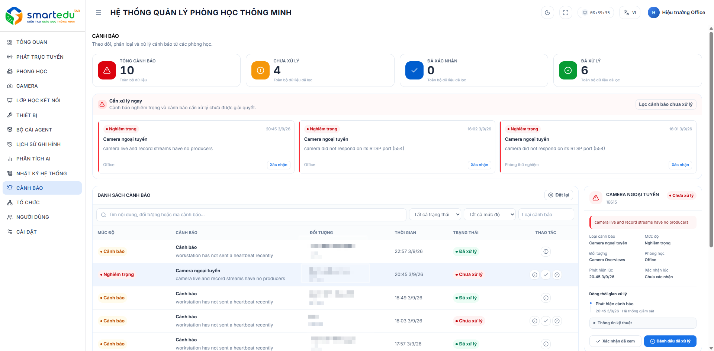

# Quản lý cảnh báo

### Giao diện

<figure><figcaption>
Hình 11-1. Màn hình Cảnh báo hệ thống.
</figcaption></figure>

***

### Thành phần giao diện

<table><thead><tr><th width="101">STT</th><th>Thành phần</th><th>Mô tả</th></tr></thead><tbody><tr><td>1</td><td>Thống kê cảnh báo</td><td>Hiển thị tổng số cảnh báo, cảnh báo đang mở, đã ghi nhận và đã giải quyết.</td></tr><tr><td>2</td><td>Bộ lọc</td><td>Lọc cảnh báo theo trạng thái, mức độ, loại, Entity Type và Entity ID.</td></tr><tr><td>3</td><td>Danh sách cảnh báo</td><td>Hiển thị các cảnh báo đang có trong hệ thống.</td></tr><tr><td>4</td><td>Thao tác</td><td>Thực hiện ghi nhận hoặc giải quyết cảnh báo.</td></tr></tbody></table>

***

### Thông tin hiển thị

Mỗi cảnh báo bao gồm các thông tin:

* Nội dung cảnh báo
* Loại cảnh báo
* Mức độ
* Trạng thái
* Thời gian phát sinh
* Thao tác xử lý

***

### Mức độ cảnh báo

| Mức độ       | Ý nghĩa                                                    |
| ------------ | ---------------------------------------------------------- |
| Cảnh báo     | Sự cố cần theo dõi.                                        |
| Nghiêm trọng | Sự cố ảnh hưởng đến hoạt động của hệ thống, cần xử lý sớm. |

***

### Tìm kiếm và lọc

Người dùng có thể tìm kiếm hoặc lọc cảnh báo theo các tiêu chí:

* Trạng thái
* Mức độ
* Loại cảnh báo
* Entity Type
* Entity ID

Sau khi lựa chọn điều kiện phù hợp, danh sách cảnh báo sẽ được cập nhật theo kết quả tìm kiếm.
