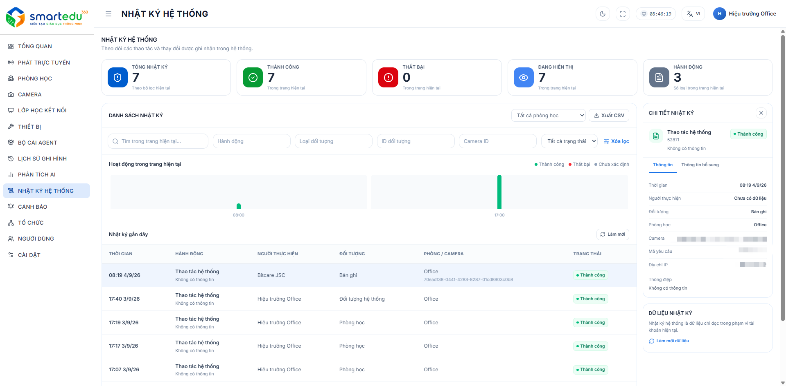

# Nhật ký hệ thống

### Giao diện

<figure><figcaption>
Hình 12-1. Màn hình Nhật ký hệ thống.
</figcaption></figure>

***

### Thành phần giao diện

<table><thead><tr><th width="143.4000244140625">STT</th><th>Thành phần</th><th>Mô tả</th></tr></thead><tbody><tr><td>1</td><td>Thống kê</td><td>Hiển thị tổng số bản ghi, số bản ghi đang hiển thị, giới hạn hiển thị và Offset.</td></tr><tr><td>2</td><td>Bộ lọc</td><td>Tìm kiếm nhật ký theo Action, Entity Type, Entity ID, Room ID, Camera ID và Status.</td></tr><tr><td>3</td><td>Danh sách nhật ký</td><td>Hiển thị toàn bộ các bản ghi nhật ký của hệ thống.</td></tr><tr><td>4</td><td>Xem chi tiết</td><td>Hiển thị đầy đủ thông tin của bản ghi nhật ký được chọn.</td></tr></tbody></table>

***

### Thông tin hiển thị

Mỗi bản ghi nhật ký bao gồm:

* Audit ID
* Action
* Actor
* Entity
* Trạng thái
* Thời gian thực hiện
* Thao tác

***

### Tìm kiếm và lọc

Người dùng có thể tìm kiếm và lọc danh sách nhật ký.

Danh sách nhật ký sẽ được cập nhật theo điều kiện đã chọn.

***

### Lưu ý

* Nhật ký hệ thống chỉ có chức năng tra cứu và theo dõi.
* Người dùng không thể chỉnh sửa hoặc xóa các bản ghi nhật ký.
* Dữ liệu nhật ký được hệ thống ghi nhận tự động nhằm phục vụ công tác giám sát và kiểm tra lịch sử hoạt động.
