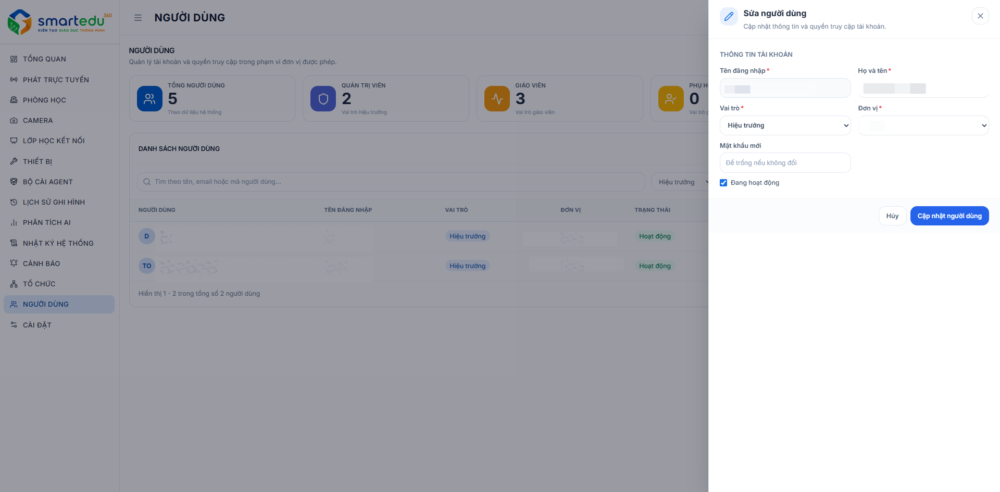

# Sửa thông tin người dùng

Chức năng **Sửa thông tin người dùng** cho phép cập nhật thông tin tài khoản, thay đổi vai trò, đơn vị quản lý, trạng thái hoạt động hoặc đặt lại mật khẩu của người dùng.

#### Giao diện

<figure><figcaption>
Hình 13-3. Sửa thông tin người dùng.
</figcaption></figure>

***

### Thực hiện sửa thông tin

1. Truy cập **Người dùng** từ thanh menu bên trái.
2. Tại danh sách người dùng, nhấn **Sửa** (biểu tượng ✏️) ở tài khoản cần cập nhật.
3. Cửa sổ **Sửa người dùng** xuất hiện.
4. Cập nhật các thông tin cần thiết.
5. Nhấn **Lưu** để cập nhật hoặc **Hủy** để đóng cửa sổ mà không lưu thay đổi.

***

### Các trường thông tin

| Trường             | Mô tả                                                                           |
| ------------------ | ------------------------------------------------------------------------------- |
| **Username**       | Tên đăng nhập của người dùng.                                                   |
| **Họ tên**         | Họ và tên hiển thị của người dùng.                                              |
| **Vai trò**        | Chọn vai trò của tài khoản (Quản trị viên, Giáo viên...).                       |
| **Đơn vị**         | Đơn vị hoặc trường học mà người dùng trực thuộc.                                |
| **Mật khẩu mới**   | Nhập mật khẩu mới nếu muốn thay đổi. Để trống nếu giữ nguyên mật khẩu hiện tại. |
| **Đang hoạt động** | Bật hoặc tắt trạng thái hoạt động của tài khoản.                                |

***

### Thực hiện thay đổi mật khẩu

Để thay đổi mật khẩu của người dùng:

1. Mở cửa sổ **Sửa người dùng**.
2. Nhập mật khẩu mới vào trường **Mật khẩu mới**.
3. Nhấn **Lưu**.

> Nếu để trống trường **Mật khẩu mới**, hệ thống sẽ giữ nguyên mật khẩu hiện tại.

***

### Thay đổi trạng thái tài khoản

Người quản trị có thể sử dụng nút **Đang hoạt động** để:

* **Bật**: Cho phép người dùng tiếp tục đăng nhập và sử dụng hệ thống.
* **Tắt**: Vô hiệu hóa tài khoản, người dùng sẽ không thể sử dụng hệ thống cho đến khi được kích hoạt lại.

***

### Lưu ý

* Chỉ người dùng có quyền quản trị mới được phép chỉnh sửa thông tin tài khoản.
* Việc thay đổi vai trò sẽ ảnh hưởng đến quyền truy cập và các chức năng mà người dùng được sử dụng.
* Khi thay đổi đơn vị quản lý, người dùng sẽ chỉ được phép truy cập dữ liệu thuộc đơn vị mới.
* Sau khi nhấn **Lưu**, thông tin sẽ được cập nhật ngay trên hệ thống.
