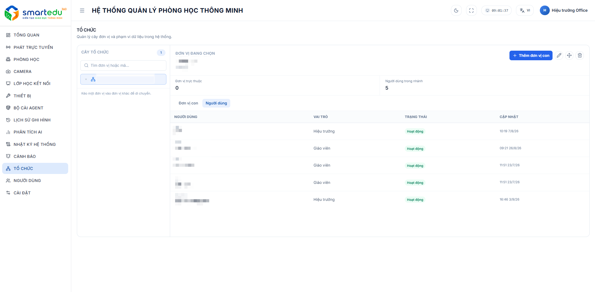

# Cơ cấu tổ chức

### Giao diện

<figure><figcaption>
Hình 14-1. Cơ cấu tổ chức.
</figcaption></figure>

***

### Truy cập chức năng

1. Chọn **Tổ chức** trên thanh menu bên trái.
2. Hệ thống hiển thị cây tổ chức và thông tin của đơn vị đang được chọn.

***

### Giao diện chức năng

Màn hình được chia thành hai khu vực:

#### Cây tổ chức

Hiển thị danh sách các đơn vị mà người dùng được phép quản lý.

Người dùng có thể:

* Tìm kiếm đơn vị.
* Chọn đơn vị để xem thông tin chi tiết.
* Mở rộng hoặc thu gọn cây tổ chức.

***

#### Thông tin đơn vị

Sau khi chọn một đơn vị, hệ thống hiển thị:

| Thông tin              | Mô tả                                              |
| ---------------------- | -------------------------------------------------- |
| Đơn vị đang chọn       | Tên đơn vị hiện tại.                               |
| Đơn vị trực thuộc      | Số lượng đơn vị con trực thuộc.                    |
| Người dùng trong nhánh | Tổng số người dùng thuộc đơn vị và các đơn vị con. |

Bên dưới là các thẻ thông tin:

* **Đơn vị con**: Danh sách các đơn vị trực thuộc.
* **Người dùng**: Danh sách người dùng thuộc đơn vị.

***

### Các thao tác

Người quản trị có thể thực hiện các thao tác sau:

| Chức năng           | Mô tả                                   |
| ------------------- | --------------------------------------- |
| **Thêm đơn vị con** | Tạo đơn vị trực thuộc đơn vị hiện tại.  |
| **Sửa**             | Cập nhật thông tin của đơn vị.          |
| **Di chuyển**       | Chuyển đơn vị sang một đơn vị cha khác. |
| **Xóa**             | Xóa đơn vị khỏi hệ thống.               |

***

### Theo dõi tổ chức

Người quản trị có thể:

* Kiểm tra số lượng đơn vị trực thuộc.
* Theo dõi số lượng người dùng trong từng đơn vị.
* Quản lý cấu trúc tổ chức theo mô hình phân cấp.

Khi đơn vị chưa có đơn vị trực thuộc, hệ thống sẽ hiển thị thông báo:

> **Chưa có đơn vị con**\
> Tạo đơn vị trực thuộc để mở rộng cấu trúc tổ chức.

***

### Lưu ý

* Chỉ người dùng có quyền quản trị mới được phép thay đổi cấu trúc tổ chức.
* Việc di chuyển hoặc xóa đơn vị có thể ảnh hưởng đến người dùng và dữ liệu thuộc đơn vị đó.
* Nên kiểm tra cấu trúc tổ chức trước khi thực hiện các thao tác chỉnh sửa hoặc xóa.
