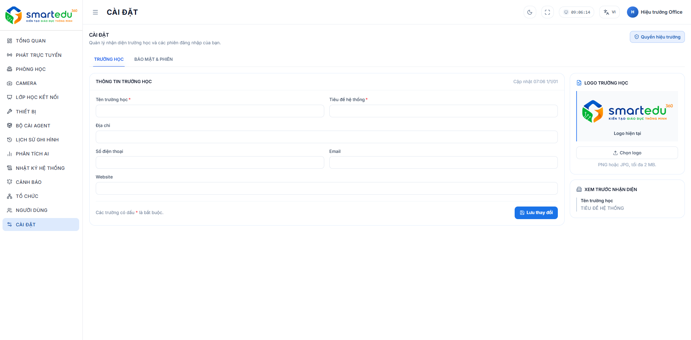

# Quản lý cài đặt

### Giao diện

<figure><figcaption>
Hình 15-1. Màn hình Cài đặt.
</figcaption></figure>

***

### Thành phần giao diện

Màn hình **Cài đặt** gồm ba nhóm cấu hình chính:

| Nhóm                 | Chức năng                                                |
| -------------------- | -------------------------------------------------------- |
| Thông tin trường học | Cập nhật logo, tên trường, địa chỉ và thông tin liên hệ. |
| Phiên làm việc       | Quản lý các phiên đăng nhập đang hoạt động.              |

***

### Cập nhật thông tin trường học

Thực hiện theo các bước sau:

#### Bước 1

Tại menu **Cài đặt**, cập nhật các thông tin cần thiết:

* Logo trường học
* Tên trường học
* Tiêu đề hệ thống
* Địa chỉ
* Số điện thoại
* Email
* Website

#### Bước 2

Nếu cần thay đổi logo:

* Nhấn **Chọn logo**.
* Chọn tệp ảnh từ máy tính (PNG hoặc JPG, tối đa 2 MB).
* Nhấn **Lưu logo**.

#### Bước 3

Sau khi hoàn tất các thông tin, nhấn **Lưu thay đổi**.

#### Kết quả

Thông tin mới được lưu và hiển thị trên giao diện hệ thống.

***

### Phiên làm việc

Hệ thống sẽ hiển thị danh sách các phiên đăng nhập đang hoạt động, thời gian đăng nhập và thời gian hết hạn của phiên. Quản trị viên có thể xóa các phiên đăng nhập đang hoạt động bằng cách nhấn **Thu hồi**.

***

### Lưu ý

* Logo tải lên phải đúng định dạng **PNG** hoặc **JPG** và không vượt quá **2 MB**.
* Thông tin sau khi lưu sẽ được áp dụng cho toàn bộ hệ thống.
* Việc thay đổi thời gian phiên làm việc có thể ảnh hưởng đến tất cả người dùng đang sử dụng hệ thống.
