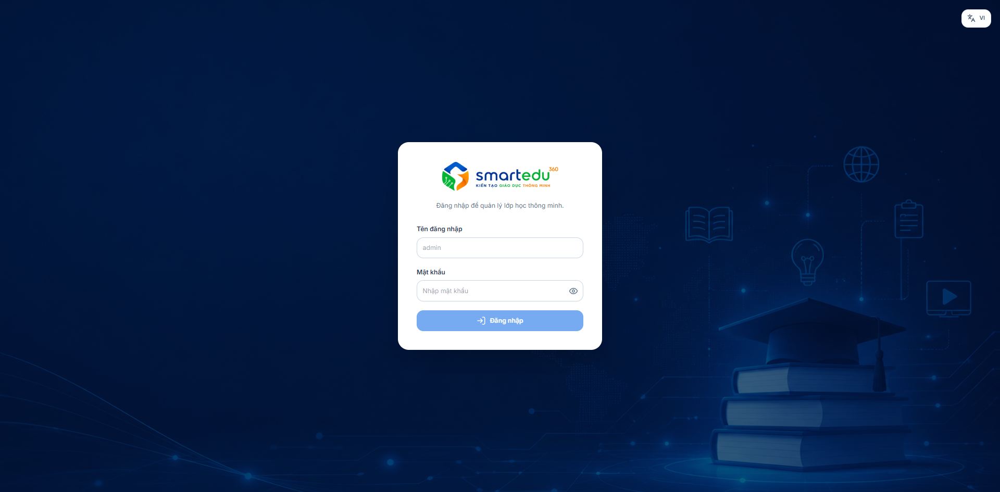

# Đăng nhập

### Điều kiện

Trước khi đăng nhập, cần đảm bảo:

* Đã được cấp tài khoản và mật khẩu.
* Thiết bị có kết nối Internet hoặc mạng nội bộ của đơn vị.

***

### Giao diện

Truy cập link: [https://iot.smartedu360.com/](https://iot.smartedu360.com/) để đăng nhập.

<figure><figcaption>
<em>Hình 2-1. Giao diện đăng nhập.</em>
</figcaption></figure>

***

### Thành phần giao diện

<table><thead><tr><th width="98.5999755859375">STT</th><th>Thành phần</th><th>Mô tả</th></tr></thead><tbody><tr><td>1</td><td>Tên đăng nhập</td><td>Nhập tài khoản được cấp.</td></tr><tr><td>2</td><td>Mật khẩu</td><td>Nhập mật khẩu tương ứng với tài khoản.</td></tr><tr><td>3</td><td>Nút <strong>Đăng nhập</strong></td><td>Thực hiện đăng nhập vào hệ thống.</td></tr></tbody></table>

***

### Các bước thực hiện

#### Bước 1

Mở trình duyệt web và truy cập địa chỉ hệ thống: [https://iot.smartedu360.com/](https://iot.smartedu360.com/)

#### Bước 2

Nhập **Tên đăng nhập**.

#### Bước 3

Nhập **Mật khẩu**.

#### Bước 4

Nhấn **Đăng nhập**.

***

### Kết quả

Nếu thông tin đăng nhập hợp lệ, hệ thống sẽ chuyển đến màn hình **Dashboard**.

Nếu thông tin không chính xác, hệ thống sẽ hiển thị thông báo lỗi và yêu cầu người dùng kiểm tra lại.

***

### Lưu ý

* Phân biệt chữ hoa và chữ thường khi nhập mật khẩu.
* Không chia sẻ tài khoản cho người khác.
* Không lưu mật khẩu trên máy tính công cộng.
