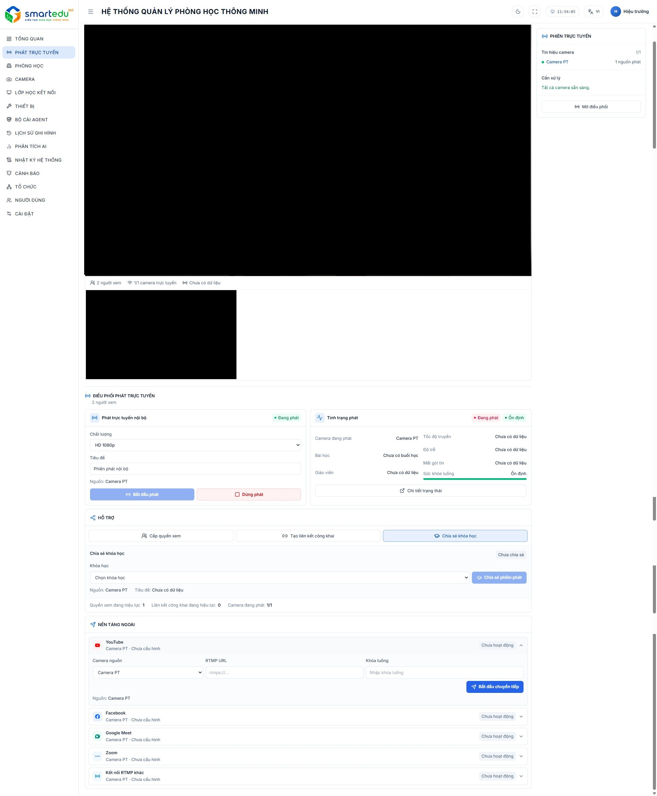

# Quản lý phiên Live

### Giao diện

<figure><figcaption>
Hình 4-2. Giao diện Quản lý phiên Live.
</figcaption></figure>

Giao diện gồm các khu vực chính:

* Các chỉ số trạng thái phiên phát.
* Khu vực xem Live nội bộ.
* Danh sách camera và trạng thái camera.
* Điều phối phát trực tuyến.
* Thông tin & tình trạng Live.
* Khu vực hỗ trợ chia sẻ Live.
* Khu vực chia sẻ Live theo khóa học.
* Khu vực đẩy luồng ra nền tảng ngoài.

### Các chỉ số trạng thái

Phía trên màn hình hiển thị các trạng thái giúp người dùng theo dõi nhanh tình trạng của phiên phát.

Các trạng thái có thể bao gồm:

* **Đang phát:** phiên Live hiện đang hoạt động.
* **Ổn định:** tình trạng luồng đang hoạt động bình thường.

Các trạng thái này giúp người dùng nhanh chóng xác định phiên phát có đang hoạt động và có ổn định hay không.

### Xem Live nội bộ

Khu vực **Xem Live nội bộ** là khu vực chính dùng để theo dõi hình ảnh trực tiếp từ camera đang được chọn.

Trên giao diện, khu vực Live hiển thị tên camera đang được theo dõi, ví dụ **Camera Box 2**.

Bên dưới khung Live, hệ thống hiển thị một số thông tin tổng quan của phiên phát như:

* Số người xem.
* Số camera đang phát trực tuyến.
* Thời lượng phiên phát.

Khi camera chưa có luồng hình ảnh hoặc chưa sẵn sàng, khu vực xem Live có thể hiển thị màn hình đen.

Người dùng có thể theo dõi trạng thái camera và phiên phát trực tiếp ngay trên khu vực này.

### Chọn camera theo dõi

Khu vực bên phải màn hình hiển thị thông tin camera phục vụ phát trực tuyến.

Mỗi camera có thể hiển thị:

* Tên camera.
* Trạng thái camera.
* Số lượng người phát.
* Tình trạng cấu hình.
* Trạng thái sẵn sàng của camera.

Ví dụ trên giao diện là **Camera Box 2**, đang ở trạng thái sẵn sàng.

Để chuyển sang theo dõi một camera khác:

1. Xác định camera cần theo dõi.
2. Kiểm tra trạng thái camera.
3. Chọn camera tương ứng.
4. Kiểm tra hình ảnh được hiển thị tại khu vực **Xem Live nội bộ**.

Chỉ camera đang hoạt động và có luồng hợp lệ mới có thể được sử dụng để phát Live.

### Phát Live nội bộ

Khu vực **Điều phối phát trực tuyến** cho phép người dùng cấu hình và điều khiển phiên phát Live trong hệ thống.

#### Bắt đầu phiên phát

Tại khu vực **Phát trực tuyến nội bộ**, người dùng cần cấu hình các thông tin:

* **Chất lượng:** lựa chọn chất lượng phát, ví dụ **HD 720p**.
* **Tiêu đề:** nhập tiêu đề cho phiên Live.
* **Nguồn:** camera được sử dụng để phát, ví dụ **Camera Box 2**.

Sau khi hoàn tất cấu hình, nhấn **Bắt đầu phát** để bắt đầu phiên Live nội bộ.

Khi phiên phát được khởi tạo thành công, hệ thống cập nhật trạng thái phiên và hiển thị trạng thái tương ứng trên giao diện.

#### Dừng phiên phát

Để dừng phiên Live nội bộ:

1. Xác định phiên phát hiện tại đang hoạt động.
2. Nhấn **Dừng phát**.
3. Chờ hệ thống cập nhật trạng thái.
4. Kiểm tra lại khu vực trạng thái để bảo đảm phiên phát đã kết thúc.

Việc dừng Live nội bộ không nhất thiết làm dừng các luồng đang được đẩy ra nền tảng ngoài.

### Thông tin & tình trạng Live

Khu vực **Thông tin & tình trạng Live** hiển thị thông tin của phiên phát hiện tại.

Các thông tin trên giao diện có thể bao gồm:

* **Camera đang phát:** camera hiện đang sử dụng để phát Live.
* **Tốc độ luồng:** thông tin tốc độ của luồng phát.
* **Bài học:** thông tin bài học được gắn với phiên phát.
* **Giáo viên:** giáo viên phụ trách.
* **Sức khỏe luồng:** tình trạng hoạt động của luồng.

Trạng thái **Ổn định** cho biết luồng đang hoạt động bình thường.

Người dùng có thể dựa vào các thông tin này để kiểm tra nhanh tình trạng của phiên Live.

Ví dụ:

* Camera không sẵn sàng → cần kiểm tra lại camera nguồn.
* Sức khỏe luồng không ổn định → cần kiểm tra camera hoặc kết nối mạng.
* Tốc độ luồng không phù hợp → có thể ảnh hưởng đến chất lượng hình ảnh.

### Hỗ trợ

Khu vực **Hỗ trợ** cung cấp các chức năng liên quan đến việc chia sẻ phiên Live.

Các chức năng gồm:

* **Chia sẻ quyền xem**
* **Tạo liên kết công khai**
* **Chia sẻ khóa học**

#### Chia sẻ quyền xem

Cho phép thiết lập quyền xem Live cho người dùng theo cơ chế phân quyền của hệ thống.

Người dùng thực hiện lựa chọn **Chia sẻ quyền xem** và thiết lập phạm vi người được phép truy cập phiên Live.

#### Tạo liên kết công khai

Cho phép tạo liên kết để chia sẻ phiên Live.

Sau khi tạo liên kết, người dùng có thể sử dụng liên kết theo phạm vi quyền được hệ thống cho phép.

#### Chia sẻ Live theo khóa học

Khu vực **Chia sẻ khóa học** cho phép gắn phiên Live với một khóa học cụ thể.

Để chia sẻ Live theo khóa học:

1. Chọn khóa học cần chia sẻ.
2. Kiểm tra thông tin khóa học.
3. Nhấn **Chia sẻ phát**.
4. Kiểm tra trạng thái sau khi chia sẻ.

Chức năng này giúp người dùng phân phối phiên Live đến đúng khóa học hoặc nhóm người học.

### Đẩy Live ra nền tảng ngoài

Khu vực **Nền tảng ngoài** cho phép đẩy luồng Live từ hệ thống ra các nền tảng hoặc máy chủ bên ngoài.

Các nền tảng hiển thị trên giao diện gồm:

* **YouTube**
* **Facebook**
* **Google Meet**
* **Zoom**
* **Kết nối RTMP khác**

Mỗi nền tảng có trạng thái riêng để người dùng theo dõi việc cấu hình và đẩy luồng.

#### Cấu hình đẩy luồng

Tùy từng nền tảng, người dùng có thể cần nhập thông tin kết nối.

Đối với cấu hình RTMP, giao diện cho phép lựa chọn và nhập:

* **Camera nguồn**
* **RTMP URL**
* **Khóa luồng**

Ví dụ tại khu vực YouTube, người dùng chọn camera nguồn, nhập **RTMP URL** và **Khóa luồng**, sau đó thực hiện thao tác bắt đầu chuyển tiếp luồng.

Thông tin RTMP URL và Khóa luồng phải được nhập chính xác và cần được bảo mật.

#### Bắt đầu đẩy luồng

Để đẩy Live ra nền tảng ngoài:

1. Mở nền tảng cần sử dụng.
2. Chọn camera nguồn.
3. Nhập thông tin kết nối tương ứng.
4. Kiểm tra lại RTMP URL và Khóa luồng nếu sử dụng RTMP.
5. Nhấn nút bắt đầu chuyển tiếp/đẩy luồng.
6. Theo dõi trạng thái của nền tảng.

#### Dừng đẩy luồng

Khi không còn nhu cầu phát ra nền tảng ngoài:

1. Xác định nền tảng đang nhận luồng.
2. Thực hiện thao tác dừng chuyển tiếp/đẩy luồng.
3. Kiểm tra trạng thái nền tảng đã trở về trạng thái không hoạt động.

Việc dừng luồng trên nền tảng ngoài và việc dừng **Live nội bộ** là hai thao tác độc lập.

### Danh sách camera Restream

Bên dưới khu vực cấu hình nền tảng ngoài, hệ thống hiển thị danh sách camera phục vụ việc Restream.

Thông tin trên danh sách giúp người dùng theo dõi:

* Camera nguồn.
* Tình trạng cấu hình.
* Trạng thái Restream.
* Trạng thái hoạt động của camera.

Danh sách này giúp xác định nhanh camera nào đã được cấu hình để đẩy luồng ra nền tảng ngoài và camera nào chưa được sử dụng.

### Lưu ý

* Cần bảo đảm camera đang ở trạng thái sẵn sàng trước khi bắt đầu Live.
* Kiểm tra hình ảnh tại khu vực **Xem Live nội bộ** trước khi phát.
* Lựa chọn chất lượng phát phù hợp với camera và đường truyền.
* Theo dõi **Thông tin & tình trạng Live** trong suốt quá trình phát.
* Thông tin **RTMP URL** và **Khóa luồng** cần được bảo mật.
* Live nội bộ và đẩy luồng ra nền tảng ngoài là hai chức năng độc lập.
* Trước khi dừng phiên Live nội bộ, cần kiểm tra các nền tảng ngoài đang sử dụng để tránh làm gián đoạn luồng đang được chia sẻ.
