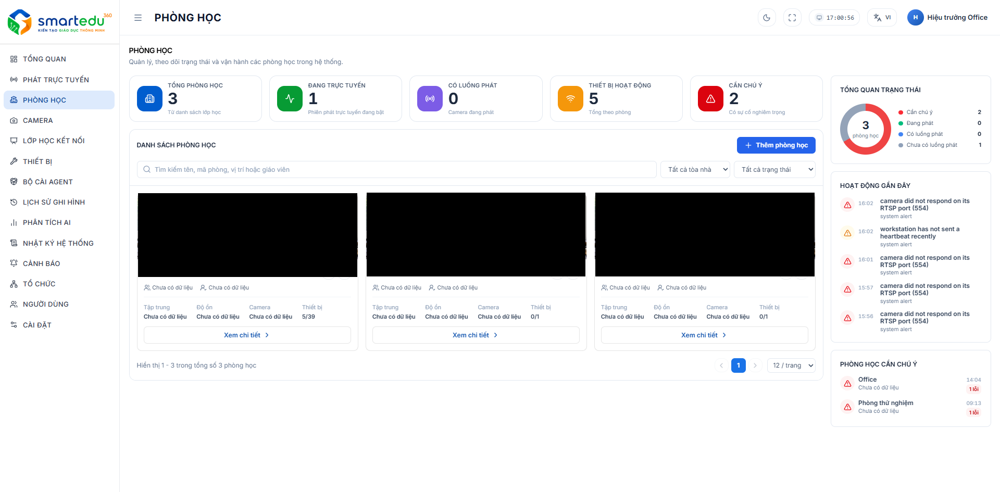

# Danh sách phòng học

### Giao diện

<figure><figcaption>
Hình 5-1. Danh sách phòng học.
</figcaption></figure>

***

Giao diện gồm các khu vực chính:

* Thống kê tổng quan.
* Danh sách phòng học.
* Tìm kiếm và lọc phòng học.
* Tổng quan trạng thái phòng học.
* Hoạt động gần đây.
* Phòng học cần chú ý.

### Các thành phần trên màn hình

#### Thống kê tổng quan

Phần trên cùng của màn hình hiển thị các chỉ số tổng quan giúp người dùng nhanh chóng nắm được tình trạng phòng học và thiết bị trong hệ thống.

Các chỉ số gồm:

* **Tổng phòng học:** tổng số phòng học đang được quản lý.
* **Đang trực tuyến:** số phòng đang có phiên phát trực tuyến.
* **Có luồng phát:** số phòng có camera đang có luồng phát.
* **Thiết bị hoạt động:** tổng số thiết bị đang hoạt động trong các phòng học.
* **Cần chú ý:** số phòng đang có vấn đề hoặc cần người dùng kiểm tra.

Các chỉ số được cập nhật theo trạng thái hiện tại của hệ thống.

#### Danh sách phòng học

Khu vực **Danh sách phòng học** hiển thị các phòng học đang được quản lý.

Người dùng có thể sử dụng ô tìm kiếm để tìm phòng theo:

* Tên phòng.
* Mã phòng.
* Vị trí.
* Giáo viên.

Bên cạnh ô tìm kiếm, người dùng có thể lọc danh sách theo:

* **Tòa nhà:** lựa chọn phòng thuộc một tòa nhà cụ thể hoặc xem tất cả tòa nhà.
* **Trạng thái:** lọc phòng theo trạng thái hoạt động tương ứng.

Nút **Thêm phòng học** cho phép người dùng tạo mới một phòng học trong hệ thống.

#### Thông tin phòng học

Mỗi phòng học được hiển thị dưới dạng một thẻ riêng.

Trên thẻ phòng học có thể hiển thị:

* Hình ảnh phòng học.
* Tên phòng học.
* Trạng thái phòng, ví dụ:
  * **Đang phát**
  * **Có luồng phát**
* Giáo viên hoặc thông tin người phụ trách.
* Các thông tin trạng thái của phòng.

Phần thông tin chi tiết của phòng có thể bao gồm:

* **Tập trung:** trạng thái hoặc dữ liệu tập trung của phòng.
* **Độ ồn:** thông tin về mức độ tiếng ồn trong phòng.
* **Camera:** trạng thái hoặc dữ liệu camera.
* **Thiết bị:** tình trạng thiết bị trong phòng.

Thông tin thiết bị được thể hiện dưới dạng số lượng thiết bị đang hoạt động trên tổng số thiết bị của phòng.

Người dùng có thể sử dụng các nút thao tác trên thẻ phòng để chỉnh sửa hoặc thực hiện các thao tác quản lý phòng.

#### Xem chi tiết

Nhấn **Xem chi tiết** trên thẻ phòng học để mở trang thông tin chi tiết của phòng.

Tại trang chi tiết, người dùng có thể theo dõi và quản lý các thông tin, camera, thiết bị và trạng thái vận hành của phòng.

#### Tổng quan trạng thái

Khu vực **Tổng quan trạng thái** hiển thị biểu đồ thống kê số lượng phòng học theo từng trạng thái.

Các trạng thái được thể hiện gồm:

* **Cần chú ý:** các phòng đang có vấn đề cần kiểm tra.
* **Đang phát:** các phòng hiện đang có phiên phát trực tuyến.
* **Có luồng phát:** các phòng có camera hoặc luồng phát đang hoạt động.
* **Chưa có luồng phát:** các phòng chưa có luồng phát.

Biểu đồ giúp người dùng nhanh chóng đánh giá tình trạng tổng thể của các phòng học mà không cần kiểm tra từng phòng.

#### Hoạt động gần đây

Khu vực **Hoạt động gần đây** hiển thị các thay đổi hoặc sự kiện mới nhất liên quan đến phòng học.

Thông tin tại đây giúp người dùng theo dõi các hoạt động phát sinh trong hệ thống và nhanh chóng nhận biết những vấn đề cần kiểm tra.

Các hoạt động có thể được hiển thị kèm biểu tượng cảnh báo khi hệ thống phát hiện sự kiện cần chú ý.

#### Phòng học cần chú ý

Khu vực **Phòng học cần chú ý** hiển thị các phòng đang có vấn đề hoặc cần người dùng kiểm tra.

Nếu không có phòng nào cần xử lý, hệ thống hiển thị thông báo:

**Không có phòng cần chú ý.**

Khu vực này giúp người dùng nhanh chóng xác định các phòng cần được kiểm tra mà không phải rà soát toàn bộ danh sách.

#### Phân trang danh sách

Bên dưới danh sách phòng học hiển thị thông tin số lượng phòng đang được hiển thị và tổng số phòng trong hệ thống.

Người dùng có thể:

* Chuyển sang trang trước hoặc trang tiếp theo.
* Chọn số lượng phòng hiển thị trên mỗi trang.

### Lưu ý

* Trạng thái phòng học được hiển thị theo tình trạng thực tế của phòng và các thiết bị liên quan.
* Trạng thái **Đang phát** cho biết phòng đang có phiên phát trực tuyến.
* Trạng thái **Có luồng phát** cho biết phòng có luồng phát từ camera.
* Khi phòng xuất hiện trong khu vực **Phòng học cần chú ý**, người dùng nên mở chi tiết phòng để kiểm tra nguyên nhân.
* Các thông tin như trạng thái camera, thiết bị và luồng phát có thể thay đổi theo tình trạng hoạt động thực tế của hệ thống.
