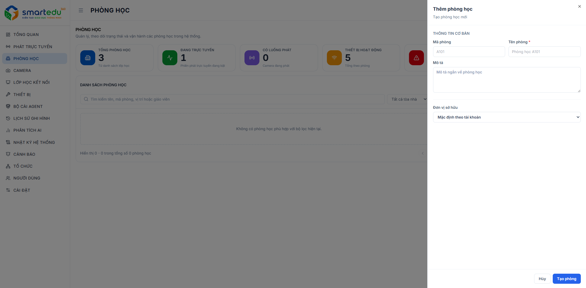

# Thêm phòng học

### Giao diện

<figure><figcaption>
Hình 5-2. Thêm phòng học.
</figcaption></figure>

***

### Thông tin cần nhập

| Trường thông tin | Bắt buộc | Mô tả                              |
| ---------------- | -------- | ---------------------------------- |
| Mã phòng         | Không    | Mã ngắn của phòng học.             |
| Tên phòng        | Có       | Tên hiển thị của phòng học.        |
| Đơn vị           | Không    | Đơn vị của phòng học.              |
| Mô tả            | Không    | Thông tin mô tả thêm về phòng học. |

***

### Các bước thực hiện

#### Bước 1

Chọn menu **Phòng học**.

#### Bước 2

Nhấn **Thêm phòng học**.

#### Bước 3

Nhập đầy đủ các thông tin cần thiết.

#### Bước 4

Kiểm tra lại thông tin.

#### Bước 5

Nhấn **Tạo phòng** để lưu.

***

### Kết quả

Nếu thông tin hợp lệ:

* Phòng học được tạo thành công.
* Phòng học sẽ xuất hiện trong danh sách.

***

### Lưu ý

* Các trường có dấu (\*) là bắt buộc.
* ID phòng không được trùng với phòng đã tồn tại.
* Chỉ những người dùng được cấp quyền mới có thể thêm phòng học.
* Nên đặt tên phòng theo đúng tên thực tế để thuận tiện quản lý.
