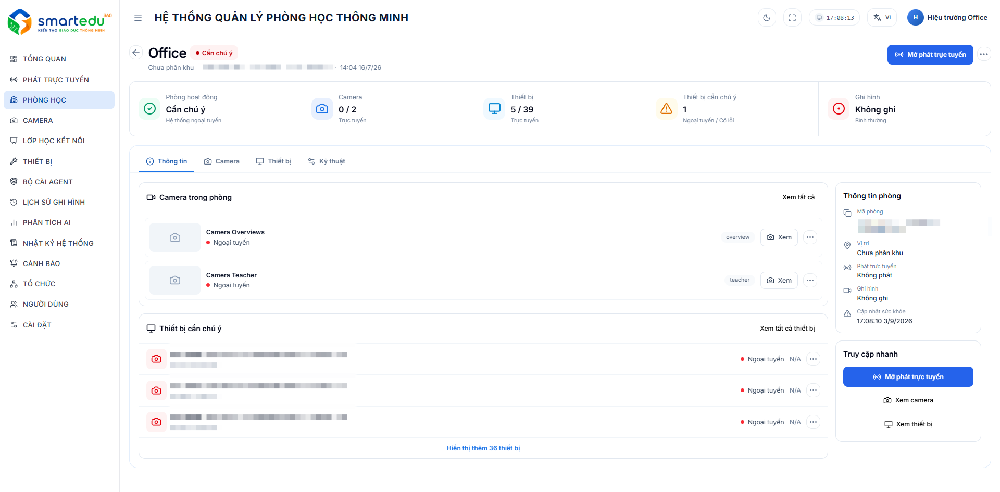
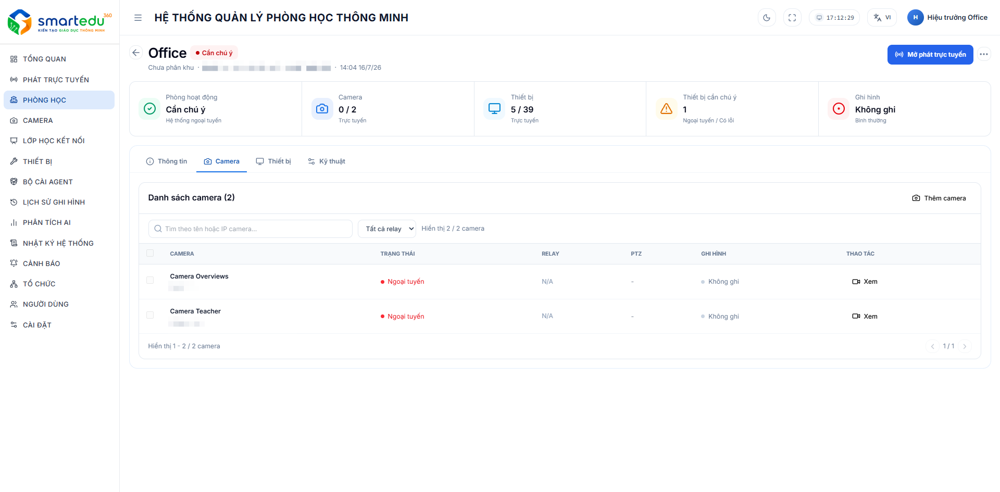
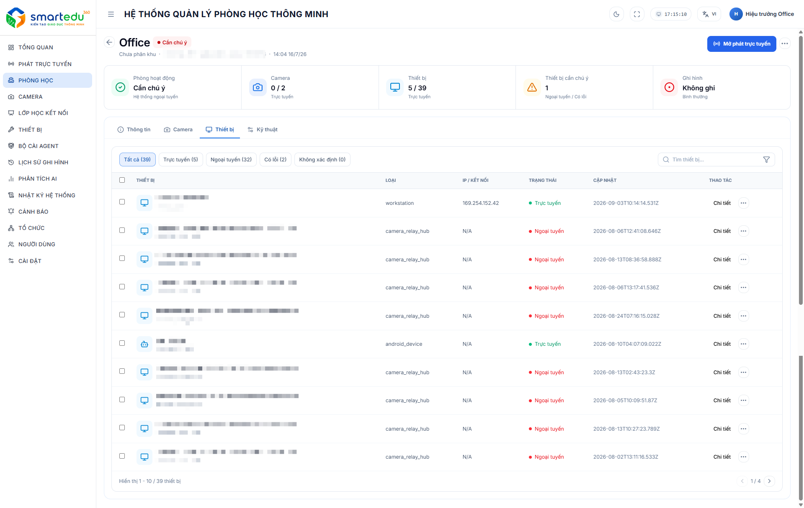
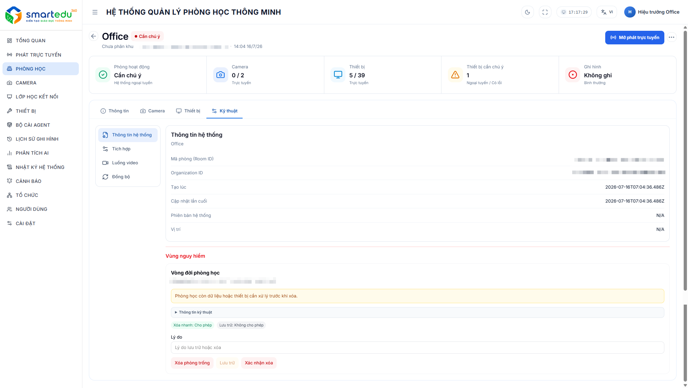

# Xem chi tiết phòng học

### Giao diện

<figure><figcaption>
Hình 5-3. Thông tin phòng học.
</figcaption></figure>

<figure><figcaption>
Hình 5-4. Thông tin các Camera của phòng học.
</figcaption></figure>

<figure><figcaption>
Hình 5-5. Thông tin các thiết bị của phòng học.
</figcaption></figure>

<figure><figcaption>
Hình 5-6. Thông tin kỹ thuật của phòng học.
</figcaption></figure>

Màn hình được chia thành các khu vực chính:

* Thanh thông tin tổng quan.
* Các thẻ chức năng.
* Nội dung chi tiết theo từng thẻ.
* Các thao tác nhanh.

***

## Thanh thông tin tổng quan

Phần đầu màn hình hiển thị các thông tin quan trọng của phòng học.

| **Thông tin**      | **Mô tả**                                                            |
| ------------------ | -------------------------------------------------------------------- |
| Tên phòng          | Tên của phòng học.                                                   |
| Trạng thái         | Trạng thái hoạt động của phòng (Đang hoạt động, Chưa có dữ liệu...). |
| Phân khu           | Phân khu hoặc khu vực quản lý của phòng học.                         |
| Thời gian cập nhật | Thời điểm đồng bộ dữ liệu gần nhất.                                  |
| Camera             | Tổng số camera và số camera đang trực tuyến.                         |
| Thiết bị           | Tổng số thiết bị và số thiết bị đang trực tuyến.                     |
| Thiết bị cần chú ý | Số lượng thiết bị ngoại tuyến hoặc gặp lỗi.                          |
| Ghi hình           | Trạng thái ghi hình của phòng học.                                   |
| Phát trực tuyến    | Nút mở nhanh phiên phát trực tiếp của phòng học.                     |

***

## Các thẻ chức năng

Trang chi tiết phòng học được chia thành nhiều thẻ để quản lý từng nhóm thông tin.

| **Thẻ**   | **Chức năng**                                                                                                  |
| --------- | -------------------------------------------------------------------------------------------------------------- |
| Thông tin | Hiển thị tổng quan phòng học, danh sách camera, các thiết bị cần chú ý, thông tin phòng và các thao tác nhanh. |
| Camera    | Quản lý toàn bộ camera thuộc phòng học, trạng thái trực tuyến, Relay, PTZ và ghi hình.                         |
| Thiết bị  | Hiển thị toàn bộ thiết bị được gán vào phòng học cùng trạng thái hoạt động và thời gian cập nhật.              |
| Kỹ thuật  | Hiển thị thông tin hệ thống, tích hợp, luồng video, đồng bộ và các chức năng quản trị vòng đời phòng học.      |

***

## Thẻ Thông tin

Thẻ **Thông tin** cung cấp cái nhìn tổng quan về phòng học.

Bao gồm các nội dung:

* Danh sách camera trong phòng.
* Danh sách thiết bị cần chú ý (Ngoại tuyến/Có lỗi).
* Thông tin phòng học:
  * Mã phòng.
  * Vị trí.
  * Trạng thái phát trực tuyến.
  * Trạng thái ghi hình.
  * Thời điểm cập nhật sức khỏe hệ thống.
* Truy cập nhanh:
  * Mở phát trực tuyến.
  * Xem camera.
  * Xem thiết bị.

***

## Thẻ Camera

Thẻ **Camera** hiển thị toàn bộ camera thuộc phòng học.

Người dùng có thể:

* Xem danh sách camera.
* Tìm kiếm theo tên hoặc địa chỉ IP.
* Lọc camera theo trạng thái.
* Bật/Tắt Relay.
* Theo dõi trạng thái:
  * Trực tuyến.
  * Ngoại tuyến.
* Kiểm tra trạng thái ghi hình.
* Xem nhanh camera.

Thông tin hiển thị gồm:

| **Cột**    | **Mô tả**                               |
| ---------- | --------------------------------------- |
| Camera     | Tên camera và địa chỉ IP.               |
| Trạng thái | Trực tuyến hoặc ngoại tuyến.            |
| Relay      | Trạng thái Relay.                       |
| PTZ        | Trạng thái điều khiển PTZ (nếu hỗ trợ). |
| Ghi hình   | Trạng thái ghi hình của camera.         |
| Thao tác   | Mở màn hình xem camera.                 |

***

## Thẻ Thiết bị

Thẻ **Thiết bị** hiển thị tất cả thiết bị đã được gán vào phòng học.

Người dùng có thể:

* Tìm kiếm thiết bị.
* Lọc theo trạng thái:
  * Tất cả.
  * Trực tuyến.
  * Ngoại tuyến.
  * Có lỗi.
  * Không xác định.
* Xem chi tiết từng thiết bị.

Thông tin hiển thị gồm:

| Cột        | Mô tả                                                     |
| ---------- | --------------------------------------------------------- |
| Thiết bị   | Tên thiết bị.                                             |
| Loại       | Loại thiết bị (Camera, Workstation, Camera Relay Hub...). |
| IP/Kết nối | Địa chỉ IP hoặc thông tin kết nối.                        |
| Trạng thái | Trực tuyến hoặc ngoại tuyến.                              |
| Cập nhật   | Thời gian cập nhật gần nhất.                              |
| Thao tác   | Xem chi tiết thiết bị.                                    |

***

## Thẻ Kỹ thuật

Thẻ **Kỹ thuật** hỗ trợ quản trị và theo dõi hệ thống của phòng học.

Bao gồm các nhóm chức năng:

### Thông tin hệ thống

Hiển thị các thông tin:

* Mã phòng (Room ID).
* Organization ID.
* Thời gian tạo.
* Thời gian cập nhật gần nhất.
* Phiên bản hệ thống.
* Vị trí.

### Tích hợp

Hiển thị trạng thái tích hợp của phòng học với các hệ thống liên quan.

### Luồng video

Quản lý thông tin các luồng video của phòng học phục vụ phát trực tiếp.

### Đồng bộ

Theo dõi trạng thái đồng bộ dữ liệu giữa phòng học và hệ thống quản lý.

### Vòng đời phòng học

Khu vực dành cho các thao tác quản trị phòng học.

Bao gồm:

* Xóa phòng.
* Lưu trữ phòng.
* Xác nhận xóa.
* Thiết lập quyền xóa nhanh.
* Nhập lý do lưu trữ hoặc xóa.

> **Lưu ý:** Chỉ có thể xóa phòng học khi đã xử lý toàn bộ dữ liệu và thiết bị liên quan.

***

## Mở phát trực tuyến

Để mở phiên phát trực tiếp của phòng học:

**Bước 1:** Nhấn **Mở phát trực tuyến** ở góc trên bên phải màn hình hoặc trong khu vực **Truy cập nhanh**.

**Bước 2:** Hệ thống mở màn hình phát trực tiếp của phòng học.

***

## Quay lại danh sách phòng học

Để quay lại màn hình quản lý phòng học:

**Bước 1:** Nhấn biểu tượng **Quay lại** ở góc trên bên trái.

**Bước 2:** Hệ thống quay về danh sách phòng học.

***

> **Lưu ý**
>
> * Dữ liệu trên trang được cập nhật theo thời gian thực.
> * Trạng thái Camera và Thiết bị được đồng bộ tự động từ hệ thống.
> * Các chức năng quản trị trong thẻ **Kỹ thuật** chỉ khả dụng đối với tài khoản có quyền phù hợp.
