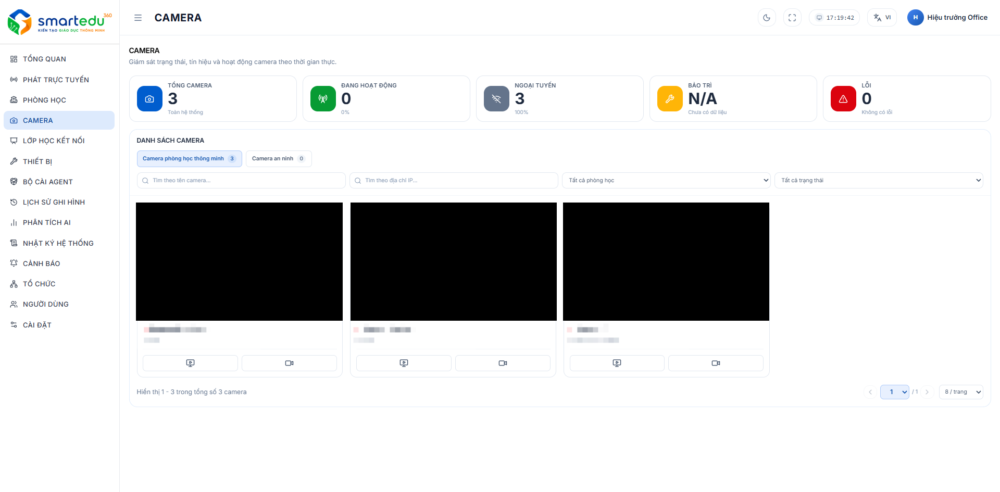

# Danh sách Camera

### Giao diện

<figure><figcaption>
Hình 6-1. Danh sách Camera.
</figcaption></figure>

### Mô tả giao diện

Màn hình bao gồm các khu vực sau:

| Thành phần       | Mô tả                                                                    |
| ---------------- | ------------------------------------------------------------------------ |
| Thống kê Camera  | Hiển thị tổng số Camera, Camera đang hoạt động, Offline, Bảo trì và Lỗi. |
| Danh sách Camera | Hiển thị các Camera đang được quản lý trong hệ thống theo phòng học.     |
| Bộ lọc           | Lọc Camera theo khu vực hoặc phòng học.                                  |
| Tìm kiếm         | Tìm Camera theo tên.                                                     |

### Thao tác

Người dùng có thể:

* Tìm kiếm Camera.
* Chọn Camera cần xem.
* Nhấn **Xem camera** để xem trực tiếp.
* Nhấn **Ghi hình** để lưu lại bản ghi.&#x20;
