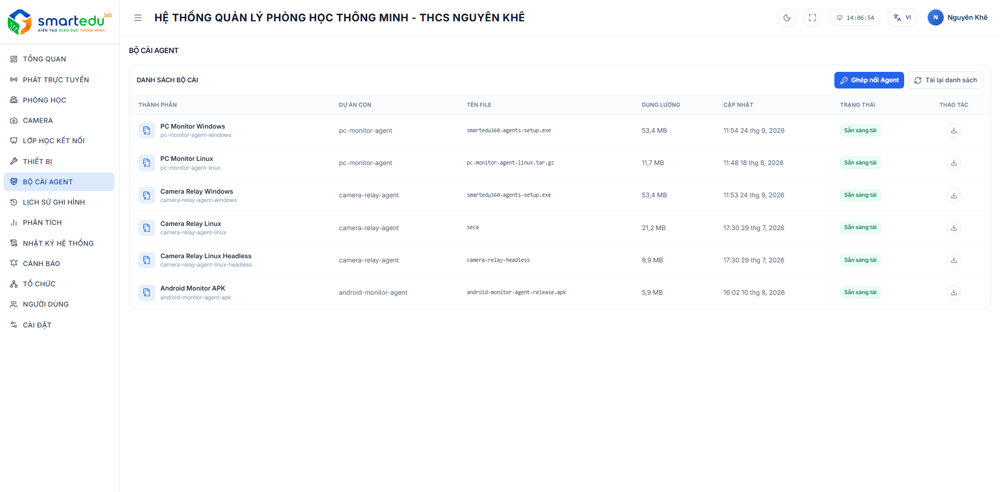
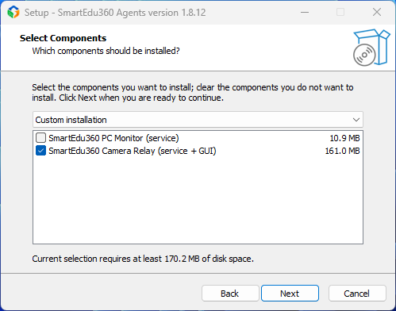
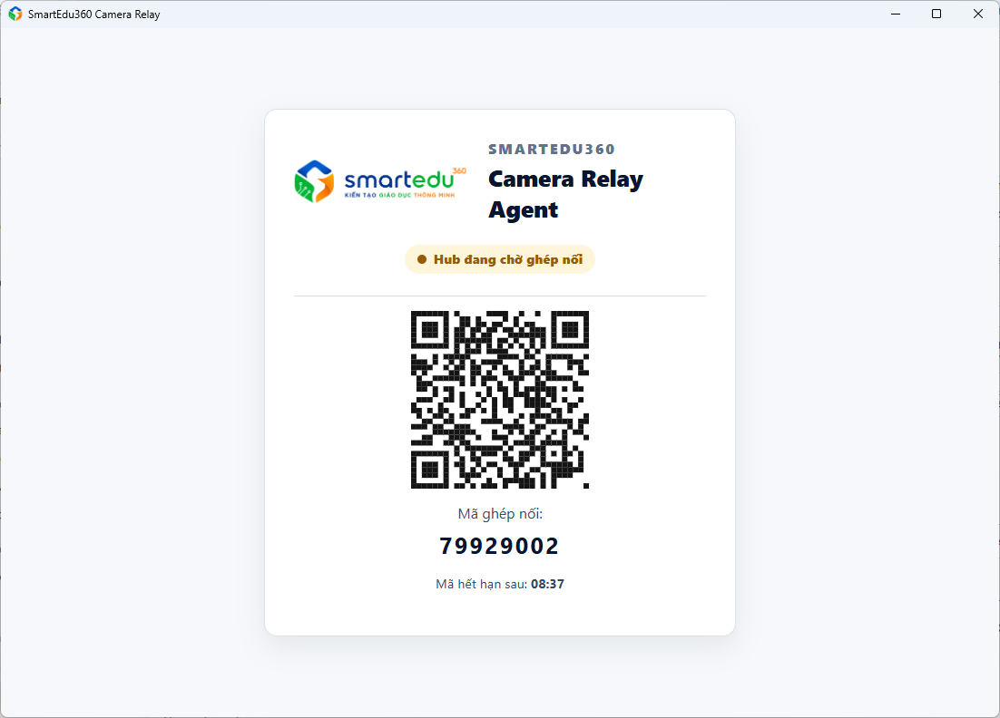
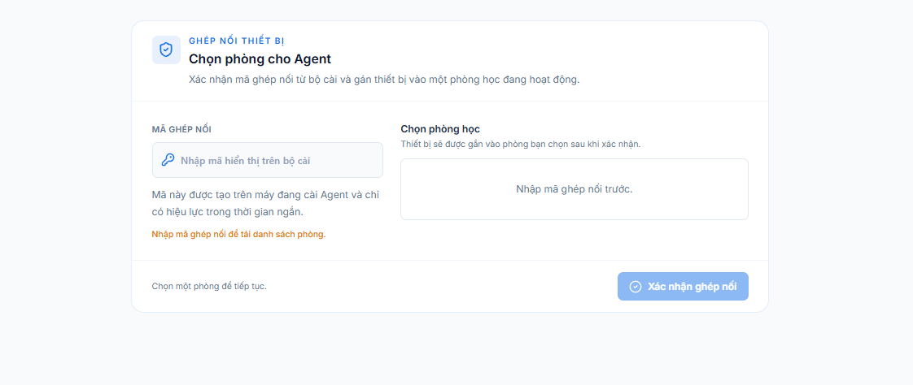
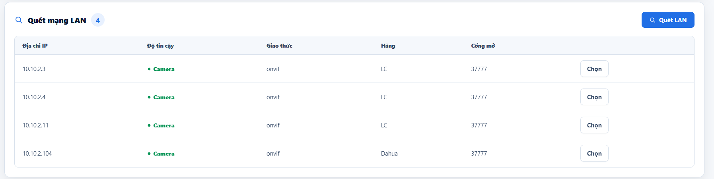
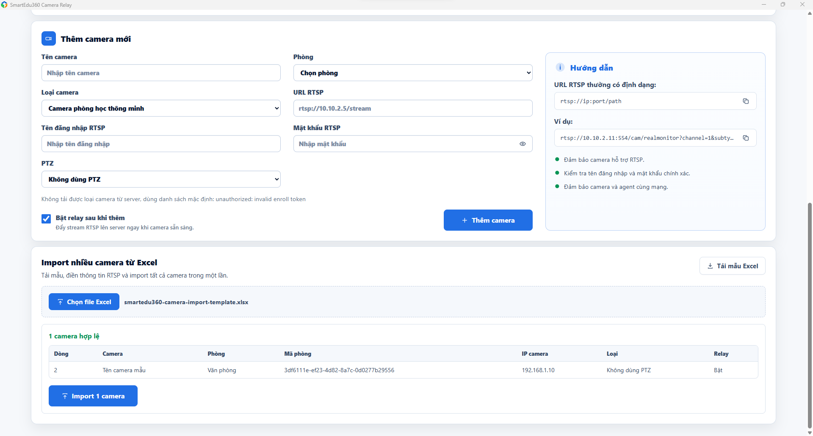

# Thêm Camera bằng bộ cài Camera Relay

### Cài đặt Bộ cài Camera Relay

Tại menu **Bộ cài Agent**:

<figure><figcaption></figcaption></figure>

1. Tải bộ cài **Camera Relay** phù hợp với hệ điều hành của thiết bị.&#x20;
2. Tiến hành cài đặt file: `smartedu360-agents-setup.exe`.
3. Ở màn hình ComponentComponents, tick chọn **SmartEdu360 Camera Relay**.

<figure><figcaption></figcaption></figure>

4. Sau khi cài đặt xong, mở Camera Relay để tiến hành ghép nối thiết bị.

<figure><figcaption></figcaption></figure>

5. Trở lại Bộ cài Agent, mở Ghép nối Agent và nhập mã ghép nối.

<figure><figcaption></figcaption></figure>

### Thêm Camera bằng Camera Relay

Sau khi Camera Relay đã được ghép nối:

1. Mở **Camera Relay Agent**, kiểm tra trạng thái Hub. Nếu Hub đã kết nối có thể tiếp tục.

<figure><figcaption></figcaption></figure>

2. Chọn **Quét LAN** để tìm các camera đang kết nối trong cùng mạng với thiết bị đang chạy Camera Relay.&#x20;
3. Nếu tìm thấy Camera, sử dụng thông tin Camera được phát hiện để cấu hình ở phần **Thêm camera mới**.&#x20;

<figure><figcaption></figcaption></figure>

4. Nếu Camera không được phát hiện, vẫn có thể thêm thủ công bằng cách nhập **URL RTSP**.
5. Nhập thông tin Camera.

<figure><figcaption></figcaption></figure>

Tại phần **Thêm camera mới**, nhập các thông tin:

| Trường                 | Cách nhập                                         |
| ---------------------- | ------------------------------------------------- |
| **Tên camera**         | Đặt tên để dễ nhận biết, ví dụ: `Camera lớp 10A1` |
| **Phòng**              | Chọn phòng học mà Camera được lắp đặt             |
| **Loại camera**        | Chọn loại Camera phù hợp                          |
| **URL RTSP**           | Nhập địa chỉ RTSP của Camera                      |
| **Tên đăng nhập RTSP** | Nhập tài khoản Camera                             |
| **Mật khẩu RTSP**      | Nhập mật khẩu Camera                              |

*   URL RTSP thường có dạng:

    `rtsp://ip:port/path`

    Ví dụ:

    `rtsp://10.10.2.11:554/cam/realmonitor?...`

    **Lưu ý:** URL RTSP, tài khoản và mật khẩu phải đúng với cấu hình của Camera.

6. Cấu hình PTZ nếu Camera hỗ trợ.

Nếu Camera có chức năng **PTZ**:

* Tại **PTZ**, chọn **Tự phát hiện** hoặc cấu hình theo Camera.
* Nhập **Máy chủ ONVIF / PTZ** nếu cần.
* Nhập **Cổng ONVIF** — mặc định đang hiển thị là `80`.
* Nhập **Tài khoản PTZ** nếu Camera yêu cầu tài khoản riêng.
* Kiểm tra tùy chọn **Dùng tài khoản RTSP cho PTZ** nếu Camera sử dụng chung tài khoản RTSP.

Nếu Camera **không hỗ trợ PTZ**, có thể chọn **Không dùng PTZ**.

7. Sau khi đã nhập đầy đủ thông tin, nhấn **Thêm camera.**&#x20;

### Trường hợp thêm nhiều Camera

Nếu cần thêm nhiều Camera cùng lúc, sử dụng phần:

**Import nhiều camera từ Excel**

1. Nhấn **Tải mẫu Excel**.&#x20;
2. Điền thông tin Camera và RTSP theo file mẫu.
3. Lưu file Excel.
4. Quay lại **Camera Relay**, nhấn **Chọn file Excel**.
5. Chọn file vừa hoàn thành.
6. Thực hiện import.&#x20;
