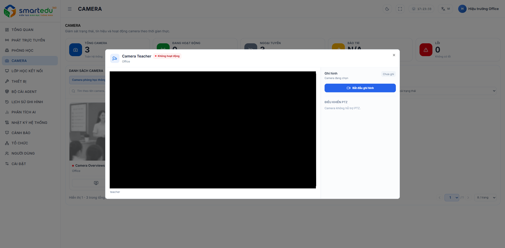

# Xem và điều khiển Camera

### Giao diện

<figure><figcaption>
Hình 6-2. Cửa sổ xem Camera.
</figcaption></figure>

### Mô tả giao diện

Cửa sổ xem Camera bao gồm các khu vực sau:

| Thành phần        | Mô tả                                                                      |
| ----------------- | -------------------------------------------------------------------------- |
| Khung hình Live   | Hiển thị hình ảnh trực tiếp từ Camera.                                     |
| Điều khiển PTZ    | Điều khiển Camera quay lên, xuống, trái, phải và Zoom (nếu camera hỗ trợ). |
| Bắt đầu ghi hình  | Bắt đầu ghi hình Camera.                                                   |

### Thao tác điều khiển

#### Điều khiển PTZ

1. Sử dụng các nút điều hướng để điều khiển Camera.
2. Điều chỉnh **Speed** nếu cần thay đổi tốc độ quay.
3. Điều chỉnh **Duration** để thay đổi thời gian thực hiện lệnh.

#### Ghi hình

1. Nhấn **Bắt đầu ghi** để bắt đầu ghi hình.
2. Nhấn **Dừng ghi** để kết thúc ghi hình.

### Kết quả

* Camera hiển thị hình ảnh trực tiếp.
* Người dùng có thể điều khiển Camera PTZ (nếu có).
* Video được ghi và lưu vào hệ thống.
* Có thể đóng cửa sổ bằng nút **Dừng xem** khi không còn nhu cầu theo dõi.

### Lưu ý

Chức năng PTZ và ghi hình chỉ khả dụng đối với Camera hỗ trợ các tính năng này.
