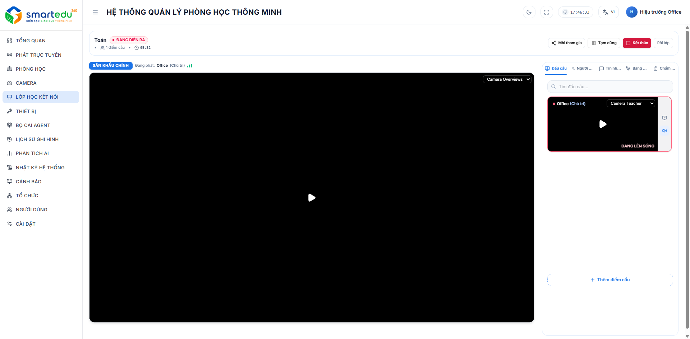

# Điều khiển phiên học

<figure><figcaption></figcaption></figure>

Sau khi tạo phiên thành công, hệ thống chuyển sang giao diện điều phối.

### Khu vực phát trực tiếp

Hiển thị luồng phát chính cùng các điểm cầu khách.

Người chủ trì có thể:

* Theo dõi luồng phát.
* Chuyển điểm cầu lên sân khấu chính.
* Giám sát trạng thái các điểm cầu.

***

### Danh sách thành viên

Hiển thị:

* Phòng chủ trì.
* Các điểm cầu tham gia.
* Người tham gia.&#x20;
* Trạng thái kết nối.
* Trạng thái phát trực tiếp.

***

### Điều khiển phiên

Người chủ trì có thể:

| Chức năng    | Mô tả                    |
| ------------ | ------------------------ |
| Mời tham gia | Mời thêm người tham gia. |
| Tạm dừng     | Tạm dừng phiên học.      |
| Kết thúc     | Kết thúc phiên học.      |
| Rời lớp      | Thoát khỏi phiên học.    |

***

### Quản lý điểm cầu

Trong phiên học, hệ thống hiển thị danh sách toàn bộ điểm cầu đang kết nối.

#### Người chủ trì

Có thể:

* Thêm điểm cầu mới.
* Đưa điểm cầu lên phát trực tiếp.
* Theo dõi trạng thái kết nối.
* Quản lý danh sách thành viên.

***

#### Điểm cầu tham gia

Sau khi tham gia thành công, người dùng có thể:

* Xem luồng phát từ phòng chủ trì.
* Theo dõi các điểm cầu khác.
* Xem danh sách thành viên.
* Giơ tay, chờ được chủ trì đưa lên phát trực tiếp.

***

### Trò chuyện trong phiên học

Trong quá trình diễn ra phiên học, người dùng có thể trao đổi thông tin với các thành viên thông qua tab **Trò chuyện**.

#### Mở cửa sổ trò chuyện

#### Bước 1

Trong giao diện phiên học, chọn tab **Trò chuyện** ở thanh bên phải.

#### Bước 2

Hệ thống hiển thị danh sách các tin nhắn đã được gửi trong phiên học.

***

#### Gửi tin nhắn

#### Bước 1

Nhập nội dung vào ô nhập tin nhắn.

#### Bước 2

Nhấn **Enter** hoặc nút **Gửi** để gửi tin nhắn.

Sau khi gửi thành công, tin nhắn sẽ được hiển thị ngay cho tất cả thành viên trong phiên học.

***

#### Nội dung hiển thị

Mỗi tin nhắn bao gồm các thông tin:

| Thông tin | Mô tả                         |
| --------- | ----------------------------- |
| Người gửi | Tên phòng học hoặc người gửi. |
| Nội dung  | Nội dung tin nhắn.            |
| Thời gian | Thời điểm gửi tin nhắn.       |

***

### Lưu ý

* Mỗi phiên học chỉ có một phòng chủ trì.
* Mã PIN chỉ có hiệu lực trong thời gian phiên học hoạt động.
* Khi phòng chủ trì kết thúc phiên học, toàn bộ điểm cầu sẽ tự động ngắt kết nối.
* Danh sách thành viên và trạng thái điểm cầu được cập nhật theo thời gian thực.
* Chỉ những thành viên đang tham gia phiên học mới có thể gửi và nhận tin nhắn.
* Tin nhắn được đồng bộ theo thời gian thực.
* Người dùng có thể chuyển đổi giữa tab **Thành viên** và **Trò chuyện** bất kỳ lúc nào mà không làm gián đoạn phiên học.

