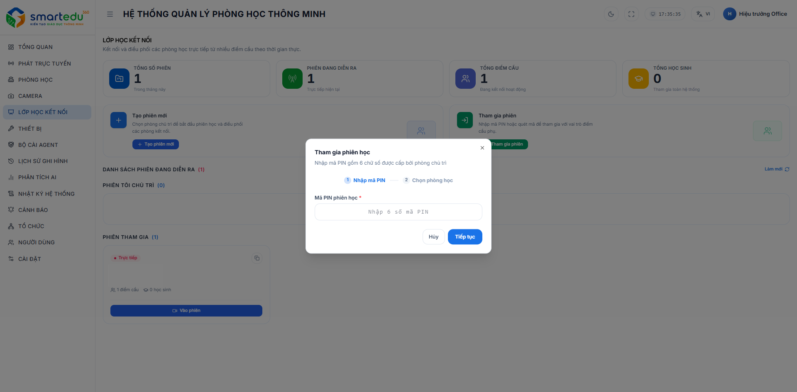

# Tham gia phiên học

<figure><figcaption></figcaption></figure>

Để tham gia một phiên học:

### Bước 1

Nhấn **Tham gia phiên**.

### Bước 2

Nhập mã PIN gồm 6 chữ số được phòng chủ trì cung cấp.

### Bước 3

Nhấn **Tiếp tục**.

### Bước 4

Chọn phòng học để tham gia và xác nhận.

Sau khi kết nối thành công, phòng học sẽ xuất hiện trong danh sách thành viên của phiên học.
