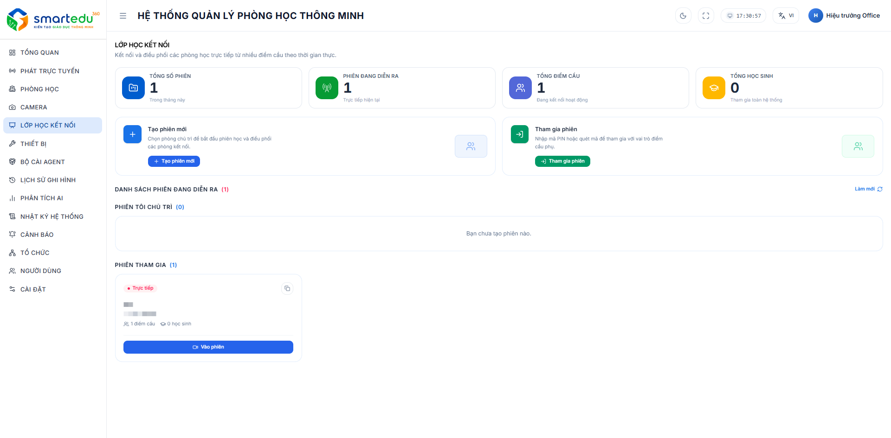

# Tổng quan Lớp học kết nối

### Giao diện

<figure><figcaption>
Hình 7-1. Giao diện Lớp học kết nối.
</figcaption></figure>

### Thông tin tổng quan

Phần đầu màn hình hiển thị các chỉ số của hệ thống.

| Thông tin          | Mô tả                                   |
| ------------------ | --------------------------------------- |
| Tổng số phiên      | Tổng số phiên học được tạo trong tháng. |
| Phiên đang diễn ra | Số phiên học đang hoạt động.            |
| Tổng điểm cầu      | Tổng số điểm cầu đang kết nối.          |
| Tổng học sinh      | Tổng số học sinh đang tham gia.         |

***

### Chức năng chính

| Chức năng      | Mô tả                           |
| -------------- | ------------------------------- |
| Tạo phiên mới  | Khởi tạo một phiên học mới.     |
| Tham gia phiên | Tham gia phiên học bằng mã PIN. |

***

### Danh sách phiên học

Trang hiển thị hai nhóm phiên:

* Phiên tôi chủ trì.
* Phiên tham gia.

Khi chưa có dữ liệu, hệ thống sẽ hiển thị thông báo tương ứng.
