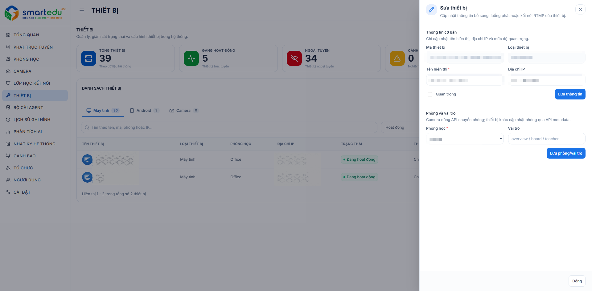

# Chỉnh sửa thiết bị

### Giao diện

<figure><figcaption>
Hình 8-4. Chỉnh sửa thiết bị.
</figcaption></figure>

### Các bước thực hiện

#### Bước 1

Truy cập **Thiết bị**.

#### Bước 2

Tìm thiết bị cần chỉnh sửa.

#### Bước 3

Nhấn vào biểu tượng **⋮** chọn **Sửa thiết bị**. Hoặc nhấn xem thiết bị và chọn **Sửa**.

#### Bước 4

Cập nhật các thông tin cần thay đổi.

#### Bước 5

Nhấn **Lưu**.

***

### Kết quả

Thông tin thiết bị được cập nhật thành công và hiển thị ngay trong danh sách.

***

### Lưu ý

Sau khi thay đổi thông tin kết nối, hệ thống sẽ kiểm tra lại trạng thái của thiết bị.
