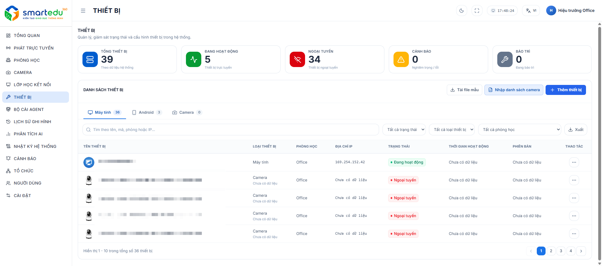

# Danh sách thiết bị

### Giao diện

<figure><figcaption>
Hình 8-1. Danh sách thiết bị.
</figcaption></figure>

***

### Thành phần giao diện

| STT | Thành phần            | Mô tả                                                     |
| --- | --------------------- | --------------------------------------------------------- |
| 1   | Thống kê thiết bị     | Hiển thị tổng số thiết bị và trạng thái hoạt động.        |
| 2   | Nút **Thêm thiết bị** | Mở cửa sổ thêm thiết bị mới.                              |
| 3   | Tab thiết bị          | Chuyển đổi giữa Máy tính, Android, Camera.                |
| 4   | Thanh tìm kiếm        | Tìm kiếm theo tên thiết bị, mã thiết bị hoặc phòng học.   |
| 5   | Bộ lọc trạng thái     | Lọc theo trạng thái hoạt động của thiết bị.               |
| 6   | Bộ lọc loại thiết bị  | Lọc theo loại thiết bị.                                   |
| 7   | Bộ lọc phòng học      | Hiển thị thiết bị thuộc phòng học được chọn.              |
| 8   | Danh sách thiết bị    | Hiển thị thông tin chi tiết của từng thiết bị.            |
| 9   | Cột thao tác          | Thực hiện xem chi tiết, chỉnh sửa hoặc các thao tác khác. |

***

### Thông tin hiển thị

Mỗi thiết bị trong danh sách bao gồm các thông tin:

* Tên thiết bị
* Loại thiết bị
* Phòng học
* Địa chỉ IP
* Trạng thái hoạt động
* Thời gian hoạt động
* Phiên bản&#x20;

***

### Trạng thái thiết bị

| Trạng thái  | Ý nghĩa                                           |
| ----------- | ------------------------------------------------- |
| Hoạt động   | Thiết bị đang kết nối và hoạt động bình thường.   |
| Ngoại tuyến | Thiết bị mất kết nối hoặc không phản hồi.         |
| Cảnh báo    | Thiết bị phát sinh cảnh báo cần kiểm tra.         |
| Bảo trì     | Thiết bị đang được bảo trì hoặc tạm dừng sử dụng. |

***

### Lưu ý

Người dùng có thể kết hợp nhiều bộ lọc để nhanh chóng tìm kiếm thiết bị cần quản lý.
