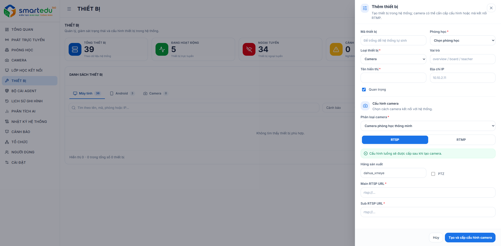

# Thêm thiết bị

### Giao diện

<figure><figcaption>
Hình 8-3. Thêm thiết bị.
</figcaption></figure>

***

### Thông tin cần khai báo

| Trường                | Mô tả                                                   |
| --------------------- | ------------------------------------------------------- |
| Mã thiết bị           | Mã thiết bị do hệ thống tự sinh.                        |
| Phòng học             | Phòng học mà thiết bị sẽ được gán.                      |
| Loại                  | Loại thiết bị (Camera hoặc NVR).                        |
| Role                  | Vai trò của thiết bị trong phòng học.                   |
| Tên hiển thị          | Tên hiển thị của thiết bị trên hệ thống.                |
| IP                    | Địa chỉ IP của thiết bị.                                |
| Quan trọng (Critical) | Đánh dấu thiết bị là thiết bị quan trọng.               |
| Kết nối camera        | Chọn kiểu kết nối RTSP hoặc RTMP.                       |
| Phân loại camera      | Chọn loại camera.                                       |
| Hãng sản xuất         | Hãng sản xuất camera.                                   |
| PTZ                   | Cho phép điều khiển quay/quét/zoom nếu thiết bị hỗ trợ. |
| Main RTSP URL         | Địa chỉ luồng RTSP chính.                               |
| Sub RTSP URL          | Địa chỉ luồng RTSP phụ.                                 |

***

### Các bước thực hiện

#### Bước 1

Truy cập **Thiết bị**.

#### Bước 2

Nhấn **Thêm thiết bị**.

#### Bước 3

Nhập đầy đủ các thông tin cấu hình.

#### Bước 4

Kiểm tra lại thông tin.

#### Bước 5

Nhấn **Tạo và cấp cấu hình camera**.

***

### Kết quả

Nếu thông tin hợp lệ:

* Thiết bị được tạo thành công.
* Thiết bị xuất hiện trong danh sách.
* Hệ thống bắt đầu kiểm tra trạng thái kết nối của thiết bị.

Nếu thông tin không hợp lệ, hệ thống sẽ hiển thị thông báo để người dùng chỉnh sửa.

***

### Lưu ý

* Device ID không được trùng với thiết bị khác.
* Địa chỉ RTSP phải chính xác để hệ thống có thể lấy hình ảnh.
* Chỉ bật PTZ đối với các camera hỗ trợ chức năng điều khiển.
