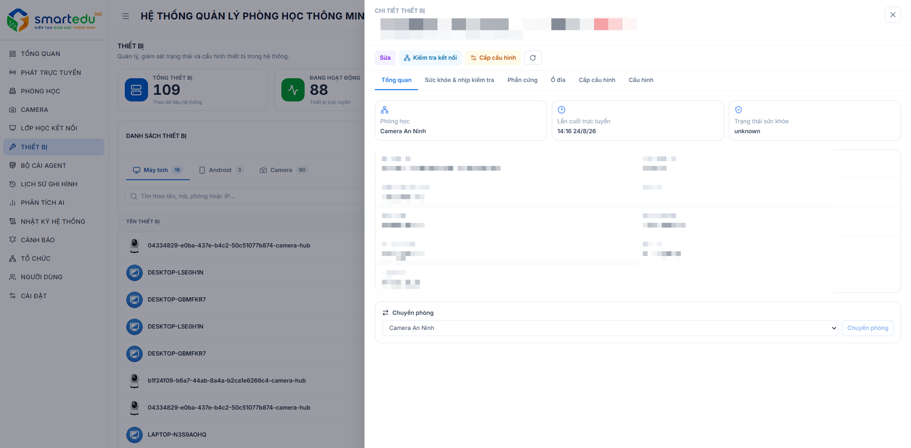

# Thông tin thiết bị

### Giao diện

<figure><figcaption>
Hình 8-2. Thông tin thiết bị.
</figcaption></figure>

***

### Truy cập chức năng

1. Truy cập **Thiết bị** từ thanh menu bên trái.
2. Chọn thiết bị cần xem trong danh sách.
3. Hệ thống hiển thị bảng thông tin chi tiết ở bên phải màn hình.

***

### Các thành phần trên màn hình

#### Thông tin chung

Khu vực đầu màn hình hiển thị các thông tin cơ bản của thiết bị:

| Thành phần      | Ý nghĩa                                                             |
| --------------- | ------------------------------------------------------------------- |
| Tên thiết bị    | Tên hiển thị của thiết bị.                                          |
| Mã thiết bị     | Mã định danh duy nhất của thiết bị.                                 |
| Trạng thái      | Hiển thị trạng thái hiện tại của thiết bị (Trực tuyến/Ngoại tuyến). |
| Phòng học       | Phòng học đang được gán cho thiết bị.                               |
| Địa chỉ IP      | Địa chỉ IP của thiết bị.                                            |
| Lần cuối online | Thời điểm thiết bị kết nối với hệ thống gần nhất.                   |

***

#### Các thao tác

Người dùng có thể thực hiện các thao tác sau:

| Chức năng        | Mô tả                                                |
| ---------------- | ---------------------------------------------------- |
| Sửa              | Chỉnh sửa thông tin thiết bị.                        |
| Kiểm tra kết nối | Kiểm tra khả năng kết nối của thiết bị với hệ thống. |
| Cấp cấu hình     | Thực hiện cấp phát hoặc đồng bộ cấu hình thiết bị.   |

***

#### Các thẻ thông tin

**Tổng quan**

Hiển thị các thông tin cơ bản của thiết bị:

| Thông tin  | Mô tả                                |
| ---------- | ------------------------------------ |
| Loại       | Loại thiết bị (Camera, NVR...).      |
| Role       | Vai trò của thiết bị trong hệ thống. |
| Connection | Giao thức kết nối.                   |
| Tạo lúc    | Thời gian tạo thiết bị.              |
| Cập nhật   | Thời gian cập nhật gần nhất.         |
| Địa chỉ IP | IP thiết bị.                         |

**Sức khỏe & nhịp kiểm tra**&#x20;

Hiển thị lịch sử hoạt động và trạng thái sức khỏe của thiết bị theo thời gian.

**Phần cứng**

Cung cấp thông tin phần cứng của thiết bị.

**Ổ đĩa**

Hiển thị sức khỏe ổ đĩa và trạng thái dung lượng lưu trữ.

**Cấp cấu hình**&#x20;

Hiển thị thông tin và trạng thái cấp phát cấu hình của thiết bị.

**Cấu hình**

Hiển thị các thông số cấu hình hiện tại của thiết bị.

***

### Theo dõi thiết bị

Người dùng nên thường xuyên kiểm tra:

* Trạng thái hoạt động của thiết bị.
* Thời gian online gần nhất.
* Lỗi gần nhất nếu thiết bị hoạt động bất thường.

Nếu thiết bị ở trạng thái **Ngoại tuyến**, nên:

1. Kiểm tra kết nối mạng.
2. Thực hiện **Kiểm tra kết nối**.
3. Kiểm tra thông tin trong mục **Sức khỏe & nhịp kiểm tra**.
4. Liên hệ quản trị viên nếu thiết bị vẫn không thể kết nối.

***

### Lưu ý

* Một số chức năng như **Chuyển phòng** chỉ khả dụng đối với người dùng có quyền quản trị.
* Thông tin trên màn hình được cập nhật theo trạng thái thực tế của thiết bị.
* Sau khi thay đổi cấu hình hoặc chuyển phòng, nên kiểm tra lại kết nối để bảo đảm thiết bị hoạt động bình thường.
