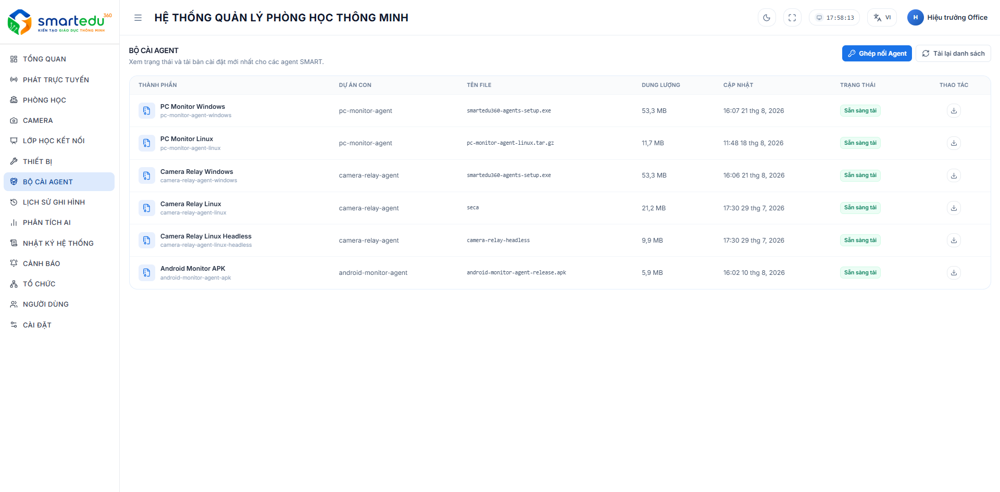

# Bộ cài Agent

## Bộ cài Agent

Trang **Bộ cài Agent** cho phép quản trị viên quản lý và tải về các bộ cài Agent phục vụ việc triển khai hệ thống **SmartEdu 360** trên các thiết bị và hệ điều hành khác nhau.

Mỗi bộ cài được cập nhật theo phiên bản mới nhất và hiển thị trạng thái sẵn sàng tải.

***

## Giao diện danh sách

Trang hiển thị danh sách tất cả các bộ cài Agent hiện có trong hệ thống.

Thông tin bao gồm:

| Cột        | Mô tả                                  |
| ---------- | -------------------------------------- |
| Thành phần | Tên Agent hoặc thành phần hệ thống.    |
| Dự án con  | Tên dự án tương ứng của Agent.         |
| Tên file   | Tên file cài đặt được phát hành.       |
| Dung lượng | Kích thước của bộ cài.                 |
| Cập nhật   | Thời gian cập nhật phiên bản gần nhất. |
| Trạng thái | Trạng thái sẵn sàng tải của bộ cài.    |
| Thao tác   | Tải bộ cài về máy tính.                |

***

## Các loại Agent

Hệ thống hỗ trợ nhiều bộ cài dành cho các nền tảng khác nhau.

| Bộ cài                      | Mô tả                                                            |
| --------------------------- | ---------------------------------------------------------------- |
| PC Monitor Windows          | Agent giám sát dành cho máy tính Windows.                        |
| PC Monitor Linux            | Agent giám sát dành cho máy tính Linux.                          |
| Camera Relay Windows        | Agent trung gian truyền dữ liệu camera trên Windows.             |
| Camera Relay Linux          | Agent trung gian truyền dữ liệu camera trên Linux.               |
| Camera Relay Linux Headless | Phiên bản Camera Relay dành cho Linux không có giao diện đồ họa. |
| Android Monitor APK         | Ứng dụng Agent dành cho thiết bị Android.                        |

***

## Tải bộ cài Agent

Để tải một bộ cài Agent:

#### Bước 1

Truy cập **Bộ cài Agent**.

#### Bước 2

Xác định bộ cài phù hợp với hệ điều hành hoặc thiết bị cần triển khai.

#### Bước 3

Kiểm tra trạng thái của bộ cài.

Chỉ các bộ cài có trạng thái **Sẵn sàng tải** mới có thể tải xuống.

#### Bước 4

Nhấn biểu tượng **Tải xuống** tại cột **Thao tác**.

Hệ thống sẽ tải file cài đặt về máy tính.

***

## Làm mới danh sách

Để cập nhật danh sách bộ cài mới nhất:

#### Bước 1

Nhấn **Tải lại danh sách**.

#### Bước 2

Hệ thống đồng bộ dữ liệu và hiển thị phiên bản bộ cài mới nhất.

***

## Ghép nối Agent

Nút **Ghép nối Agent** được sử dụng để thực hiện kết nối Agent với hệ thống quản lý.

### Quy trình ghép nối

#### Bước 1. Lấy mã ghép nối

Trên máy tính đã cài Agent:

1. Mở Agent.
2. Chọn chức năng tạo mã ghép nối.
3. Ghi lại mã được hiển thị.

> Mỗi mã chỉ có giá trị sử dụng trong thời gian ngắn nhằm đảm bảo an toàn.

***

#### Bước 2. Nhập mã

Tại màn hình **Ghép nối Agent**:

1. Nhập mã vào ô **Mã ghép nối**.
2. Hệ thống sẽ kiểm tra mã tự động.

Nếu hợp lệ:

* Danh sách phòng học sẽ được tải.

Nếu không hợp lệ:

* Hệ thống thông báo lỗi.
* Người dùng cần nhập lại mã hoặc tạo mã mới trên Agent.

***

#### Bước 3. Chọn phòng học

Sau khi danh sách phòng xuất hiện:

1. Chọn phòng muốn liên kết.
2. Kiểm tra lại thông tin.
3. Nhấn **Xác nhận ghép nối**.

***

#### Bước 4. Hoàn tất

Khi ghép nối thành công:

* Agent được liên kết với phòng học.
* Thiết bị sẽ xuất hiện trong danh sách thiết bị của phòng.
* Có thể sử dụng ngay trong các phiên học kết nối.

Hệ thống sẽ lưu cấu hình này cho đến khi Agent được ghép nối với phòng khác hoặc bị hủy ghép nối.

***

## Lưu ý

* Lựa chọn đúng bộ cài tương ứng với hệ điều hành của thiết bị.
* Nên sử dụng phiên bản mới nhất để đảm bảo tương thích và nhận đầy đủ các bản cập nhật.
* Nếu bộ cài chưa ở trạng thái **Sẵn sàng tải**, người dùng cần chờ hệ thống hoàn tất quá trình phát hành trước khi tải xuống.
